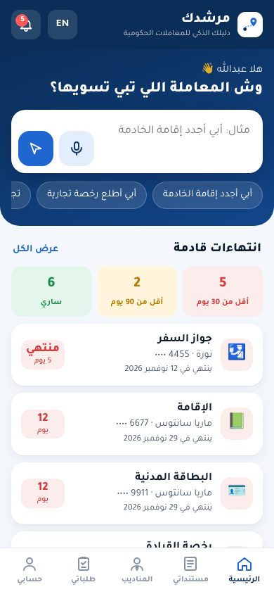

# مرشدك · Murshidak

**Your smart guide to government services in Kuwait.** Describe what you need in plain words (or by voice), e.g. «أبي أجدد إقامة الخادمة», and get a clear step-by-step roadmap: who handles each step, the documents to bring, fees, expected time, and whether it's online (Sahel) or in person.

> Murshidak is an **independent guide, not an official government app**, and it does **not** execute transactions. Every roadmap shows: «المعلومات إرشادية، تأكد من الجهة الرسمية قبل التقديم».

| Home | Roadmap | Documents | Agents |
|---|---|---|---|
|  |  |  |  |

## Run it

```bash
cd murshidak
npm install
npm start            # http://localhost:3100
npm test             # API tests (node:test)
npm run reset        # wipe local data; sample data is re-seeded on next start
```

Needs Node ≥ 22.13 (uses the built-in `node:sqlite`). The only dependency is Express.

**Demo accounts** (buttons on the sign-in screen). No SMS provider is wired yet, so the OTP is shown on screen and labeled as a demo code:

| Phone | Account |
|---|---|
| `99999999` | Family plan: spouse, 2 children, maid and driver, 13 documents, 4 bookings |
| `98888888` | Business plan: company with 5 employees' residencies |
| `90000000` | Admin: edit procedures, approve agents, advance bookings |

## Features

| Feature | Where |
|---|---|
| Onboarding (3 slides) → phone + OTP sign-in → name | `public/app.js` (`#/onboarding`, `#/login`) |
| Smart request box with mic (Web Speech, `ar-KW`) | Home screen; `POST /api/ask` |
| Request understanding: LLM picks from the library, with a local Arabic/Kuwaiti-dialect matcher as fallback | `lib/ai.js` |
| Roadmap: numbered steps, responsible entity, online/in-person per step, fees, duration, documents checklist (saved on device), Sahel link, suggested agents, disclaimer at top and bottom | `#/p/:slug` |
| Library of 20 procedures, bilingual, editable | `lib/procedures-data.js` (seed), admin panel |
| Documents wallet per family member: photo/PDF, number, expiry | `#/wallet`, `#/wallet/doc/:id` |
| Expiry dashboard (red < 30 days, yellow < 90, green) + in-app notifications at 30 and 7 days, and when expired | Home, `#/notifications`, `runReminders()` in `server.js` (runs at start, hourly, and on every change) |
| Family profiles: spouse, children, parents, domestic workers, employees (Business) | `#/family` |
| Agents marketplace: verified agents, rating, price, filters, booking; agent applications await admin approval | `#/agents`, `#/agents/apply` |
| Booking tracking: requested → accepted → in progress → done (+ cancel) | `#/bookings`, admin bookings tab |
| Plans: Free (3 documents, guides), Family (unlimited + reminders), Business (+ employees), enforced on the server | `#/plans`, `PLANS` in `server.js` |
| Admin panel: stats, add/edit/reorder procedure steps and documents, matcher keywords, publish/unpublish, approve/reject agents | `#/admin` |
| Arabic RTL by default, English toggle everywhere (UI and procedure content) | `public/i18n.js` |

## Security and privacy

- **Uploads** are stored encrypted with AES-256-GCM, outside the web root, and served only to their owner (`Cache-Control: no-store`). Type is checked against the file's magic bytes; max 5 MB. Images are resized on the device before upload.
- **ID numbers** are encrypted at rest and **masked in every list** (`•••• 1234`). The full number is returned only by `GET /api/documents/:id/number` when the owner taps "Show", and is hidden again after 15 seconds.
- **The encryption key** comes from `MURSHIDAK_SECRET`. If it isn't set, one is generated in `DATA_DIR/.secret`; back that file up, because the documents can't be decrypted without it.
- OTPs are hashed, expire after 5 minutes, allow 5 attempts, and are rate-limited per phone and per IP. Sessions are random tokens, stored hashed, in an `HttpOnly; SameSite=Lax` cookie (set `COOKIE_SECURE=1` behind HTTPS).
- Users can delete their account, which removes all their data and files.

## Configuration (`.env.example`)

Everything is optional. With no settings, the app runs in demo mode.

- `OPENAI_API_KEY`, `OPENAI_CHAT_MODEL`: turn on LLM understanding (the same provider the rest of this repo uses). The model may only return a slug that exists in the library; anything else is discarded. If the call fails or times out, the local matcher answers instead. Each answer is labeled "understood by AI" or "auto-matched".
- `SMS_PROVIDER`: setting this hides the on-screen demo code. **No SMS gateway is wired yet**, so connect one in `POST /api/auth/request-otp` before going live.
- `ADMIN_PHONES`: phone numbers that become admins when they first sign up.

## Not done yet

- **Payments:** changing plans is free in this version, and the Plans screen says so.
- **SMS delivery** for OTPs (see above).
- **Agent side:** agents don't have their own app yet; an admin moves bookings through their stages.
- **Push notifications** outside the app: reminders are in-app only.
- **Fees and durations** in the seed are approximate. Many are worded as "shown when applying" on purpose. An admin should check each one against the official entity before launch.
